# Índice de Specs

> Gerado por `spec_graph.py index` em 2026-10-13 — não edite manualmente.

## Saúde

- Validação (G0): **0 erro(s), 4 aviso(s)** — rode `spec_graph.py validate`
- Specs: approved 19, in-progress 1, implemented 6
- Impedimentos: **2 aberto(s)**, 4 resolvido(s)

## Impedimentos Abertos

| Spec | ID | Tipo | Fase/Gate | Responsável | Aberto em | Idade | Descrição |
|---|---|---|---|---|---|---|---|
| SPEC-0006 | IMP-01 | externo | G1 | thomas (provisionar a infraestrutura e cadastrar os segredos) | 2026-09-30 | 13d | Faltam domínio com DNS, VPS de staging na Hetzner, bucket de Object Storage e segredos no GitHub Environment 'staging' — os IT-01..IT-04 rodam contra o staging real |
| SPEC-0025 | IMP-01 | externo | G2 | thomas (rodar sudo npx -y playwright@1.63.0 install-deps chromium webkit) | 2026-10-13 | 0d | Os navegadores do Playwright 1.63.0 (Chromium e WebKit) não abrem neste Ubuntu 22.04 por falta de bibliotecas do sistema (libatk, libgbm, libxkbcommon, libasound, dependências do WebKit); instalar exige sudo. Bloqueia o verde do IT-01 e do IT-03 |

## Cobertura de Pilares

Perfil: **padrao**

| Pilar | Situação | Detalhe |
|---|---|---|
| Arquitetura e fronteiras | coberto | ADR-0001, ADR-0006 |
| Estratégia de testes | coberto | ADR-0011, ADR-0012, ADR-0013 |
| Qualidade de código | coberto | ADR-0014 |
| Entrega contínua e ambientes | coberto | ADR-0009 |
| Fluxo de mudança | coberto | ADR-0015 |
| Segredos e dados sensíveis | coberto | ADR-0016 |
| Identidade e acesso | coberto | ADR-0008 |
| Dependências e ciclo de vida da stack | coberto | ADR-0017 |
| Observabilidade | coberto | ADR-0010 |
| Resiliência e recuperação | coberto | ADR-0018 |
| Dados e migrações | coberto | ADR-0004 |
| Custo | coberto | ADR-0019 |

## Plano de Execução

**Em andamento:** —  
**Paradas por impedimento:** SPEC-0025  
**Próximo lote:** —

| Onda | Spec | Título | Tier/Tam. | Status | Prontidão | Observação |
|---|---|---|---|---|---|---|
| 1 | SPEC-0025 | Harness de E2E e ambiente de teste controlável | full/M | in-progress | 🚧 parada por impedimento: IMP-01 (externo → thomas (rodar sudo npx -y playwright@1.63.0 install-deps chromium webkit), 0d) |  |
| 1 | SPEC-0006 | Ambientes, IaC, segredos, migrations e backup | full/M | approved | ⛔ impedimento IMP-01 (externo → thomas (provisionar a infraestrutura e cadastrar os segredos), 13d) |  |
| 2 | SPEC-0005 | Pipeline de CI | full/M | approved | ⛔ aguarda implementação de SPEC-0025 |  |
| 3 | SPEC-0007 | Walking skeleton: página do bar e TV tocando | full/M | approved | ⛔ aguarda implementação de SPEC-0005; aguarda implementação de SPEC-0025 |  |
| 4 | SPEC-0008 | Observabilidade básica | full/M | approved | ⛔ aguarda implementação de SPEC-0007 |  |
| 4 | SPEC-0009 | Segurança básica e autorização | full/M | approved | ⛔ aguarda implementação de SPEC-0007 |  |
| 5 | SPEC-0011 | Bar, configurações da noite e termos de uso | full/M | approved | ⛔ aguarda implementação de SPEC-0007; aguarda implementação de SPEC-0008; aguarda implementação de SPEC-0009 |  |
| 5 | SPEC-0012 | Tempo real por bar | full/M | approved | ⛔ aguarda implementação de SPEC-0008; aguarda implementação de SPEC-0009 |  |
| 5 | SPEC-0013 | Entrada do cliente com comanda e PIN da TV | full/M | approved | ⛔ aguarda implementação de SPEC-0008; aguarda implementação de SPEC-0009 |  |
| 6 | SPEC-0015 | Catálogo e busca local | full/M | approved | ⛔ aguarda implementação de SPEC-0007; aguarda implementação de SPEC-0008; aguarda implementação de SPEC-0009 | saiu da onda 5: max_parallel=3 |
| 6 | SPEC-0020 | Reprodução e controle do player | full/M | approved | ⛔ aguarda implementação de SPEC-0007; aguarda implementação de SPEC-0008; aguarda implementação de SPEC-0009 | saiu da onda 5: max_parallel=3 |
| 7 | SPEC-0014 | Busca externa no YouTube com controle de cota | full/M | approved | ⛔ aguarda implementação de SPEC-0015 |  |
| 7 | SPEC-0018 | Fila justa | full/M | approved | ⛔ aguarda implementação de SPEC-0013; aguarda implementação de SPEC-0015 |  |
| 7 | SPEC-0021 | Tela da TV | full/M | approved | ⛔ aguarda implementação de SPEC-0020 |  |
| 8 | SPEC-0016 | Manutenção do catálogo | full/M | approved | ⛔ aguarda implementação de SPEC-0014 |  |
| 8 | SPEC-0022 | Bloqueio de comanda e modo ouvinte | full/M | approved | ⛔ aguarda implementação de SPEC-0013; aguarda implementação de SPEC-0018 |  |
| 8 | SPEC-0024 | Telas da fila, Minhas e pedido pela busca | full/M | approved | ⛔ aguarda implementação de SPEC-0018 |  |
| 9 | SPEC-0023 | Painel do gerente | full/M | approved | ⛔ aguarda implementação de SPEC-0021; aguarda implementação de SPEC-0022 |  |
| 9 | SPEC-0017 | Modo karaokê | full/M | approved | ⛔ aguarda implementação de SPEC-0014; aguarda implementação de SPEC-0020; aguarda implementação de SPEC-0024 |  |
| 9 | SPEC-0019 | Votos e auto-remoção | full/M | approved | ⛔ aguarda implementação de SPEC-0024 |  |

## Épicos

| Épico | Título | Status | Progresso |
|---|---|---|---|
| SPEC-0001 | Fundação do Juker | approved | 6/12 implementadas |
| SPEC-0010 | MVP Jukebox colaborativa | approved | 0/14 implementadas |

## Grafo de Dependências

Seta contínua: depende da implementação. Seta tracejada: consome contrato.

```mermaid
flowchart LR
  subgraph E0001["SPEC-0001 · Fundação do Juker"]
    S0002["SPEC-0002<br/>Repositório, solução e tooling"]:::implemented
    S0003["SPEC-0003<br/>Harness de testes de integração e suíte…"]:::implemented
    S0004["SPEC-0004<br/>Building blocks dos módulos"]:::implemented
    S0005["SPEC-0005<br/>Pipeline de CI"]:::approved
    S0006["SPEC-0006<br/>Ambientes, IaC, segredos, migrations e …"]:::approved
    S0007["SPEC-0007<br/>Walking skeleton: página do bar e TV to…"]:::approved
    S0008["SPEC-0008<br/>Observabilidade básica"]:::approved
    S0009["SPEC-0009<br/>Segurança básica e autorização"]:::approved
    S0025["SPEC-0025<br/>Harness de E2E e ambiente de teste cont…"]:::inprogress
    S0027["SPEC-0027<br/>Pendências do review da SPEC-0003"]:::implemented
  end
  subgraph E0010["SPEC-0010 · MVP Jukebox colaborativa"]
    S0011["SPEC-0011<br/>Bar, configurações da noite e termos de…"]:::approved
    S0012["SPEC-0012<br/>Tempo real por bar"]:::approved
    S0013["SPEC-0013<br/>Entrada do cliente com comanda e PIN da…"]:::approved
    S0014["SPEC-0014<br/>Busca externa no YouTube com controle d…"]:::approved
    S0015["SPEC-0015<br/>Catálogo e busca local"]:::approved
    S0016["SPEC-0016<br/>Manutenção do catálogo"]:::approved
    S0017["SPEC-0017<br/>Modo karaokê"]:::approved
    S0018["SPEC-0018<br/>Fila justa"]:::approved
    S0019["SPEC-0019<br/>Votos e auto-remoção"]:::approved
    S0020["SPEC-0020<br/>Reprodução e controle do player"]:::approved
    S0021["SPEC-0021<br/>Tela da TV"]:::approved
    S0022["SPEC-0022<br/>Bloqueio de comanda e modo ouvinte"]:::approved
    S0023["SPEC-0023<br/>Painel do gerente"]:::approved
    S0024["SPEC-0024<br/>Telas da fila, Minhas e pedido pela bus…"]:::approved
  end
  S0002 --> S0003
  S0002 --> S0004
  S0003 -. contrato v2 .-> S0004
  S0002 --> S0005
  S0027 --> S0005
  S0025 --> S0005
  S0003 -. contrato v2 .-> S0005
  S0025 -. contrato v3 .-> S0005
  S0005 -. contrato v2 .-> S0006
  S0003 --> S0007
  S0004 --> S0007
  S0005 --> S0007
  S0025 --> S0007
  S0007 --> S0008
  S0007 --> S0009
  S0007 --> S0011
  S0008 --> S0011
  S0009 --> S0011
  S0008 --> S0012
  S0009 --> S0012
  S0008 --> S0013
  S0009 --> S0013
  S0011 -. contrato v1 .-> S0013
  S0012 -. contrato v1 .-> S0013
  S0020 -. contrato v1 .-> S0013
  S0015 --> S0014
  S0008 -. contrato v1 .-> S0014
  S0007 --> S0015
  S0008 --> S0015
  S0009 --> S0015
  S0011 -. contrato v1 .-> S0015
  S0013 -. contrato v1 .-> S0015
  S0018 -. contrato v1 .-> S0015
  S0014 --> S0016
  S0020 -. contrato v1 .-> S0016
  S0018 -. contrato v1 .-> S0016
  S0014 --> S0017
  S0020 --> S0017
  S0024 --> S0017
  S0013 --> S0018
  S0015 --> S0018
  S0011 -. contrato v1 .-> S0018
  S0012 -. contrato v1 .-> S0018
  S0024 --> S0019
  S0007 --> S0020
  S0008 --> S0020
  S0009 --> S0020
  S0018 -. contrato v1 .-> S0020
  S0012 -. contrato v1 .-> S0020
  S0022 -. contrato v1 .-> S0020
  S0020 --> S0021
  S0013 -. contrato v1 .-> S0021
  S0011 -. contrato v1 .-> S0021
  S0018 -. contrato v1 .-> S0021
  S0013 --> S0022
  S0018 --> S0022
  S0020 -. contrato v1 .-> S0022
  S0021 --> S0023
  S0022 --> S0023
  S0019 -. contrato v1 .-> S0023
  S0011 -. contrato v1 .-> S0023
  S0018 --> S0024
  S0020 -. contrato v1 .-> S0024
  S0012 -. contrato v1 .-> S0024
  S0003 --> S0025
  S0003 --> S0027
  classDef proposed fill:#fef3c7,stroke:#d97706,color:#111
  classDef approved fill:#dbeafe,stroke:#2563eb,color:#111
  classDef inprogress fill:#ede9fe,stroke:#7c3aed,color:#111
  classDef implemented fill:#dcfce7,stroke:#16a34a,color:#111
  classDef deprecated fill:#f3f4f6,stroke:#9ca3af,color:#6b7280
```

## Todas as Specs

| ID | Título | Tier | Tipo | Status | Criada | Épico | Depende de | Consome contrato |
|---|---|---|---|---|---|---|---|---|
| [SPEC-0001](SPEC-0001-fundacao-do-juker.md) | Fundação do Juker | epic | foundation | approved | 2026-09-30 | — | — | — |
| [SPEC-0002](SPEC-0002-repositorio-solucao-e-tooling.md) | Repositório, solução e tooling | full | foundation | implemented | 2026-09-30 | SPEC-0001 | — | — |
| [SPEC-0003](SPEC-0003-harness-de-testes-e-suite-de-arquitetura.md) | Harness de testes de integração e suíte de arquitetura | full | foundation | implemented | 2026-09-30 | SPEC-0001 | SPEC-0002 | — |
| [SPEC-0004](SPEC-0004-building-blocks-dos-modulos.md) | Building blocks dos módulos | full | foundation | implemented | 2026-09-30 | SPEC-0001 | SPEC-0002 | SPEC-0003@2 |
| [SPEC-0005](SPEC-0005-pipeline-de-ci.md) | Pipeline de CI | full | foundation | approved | 2026-09-30 | SPEC-0001 | SPEC-0002, SPEC-0027, SPEC-0025 | SPEC-0003@2, SPEC-0025@3 |
| [SPEC-0006](SPEC-0006-ambientes-iac-segredos-migrations-e-backup.md) | Ambientes, IaC, segredos, migrations e backup | full | foundation | approved | 2026-09-30 | SPEC-0001 | — | SPEC-0005@2 |
| [SPEC-0007](SPEC-0007-walking-skeleton-pagina-do-bar-e-tv.md) | Walking skeleton: página do bar e TV tocando | full | foundation | approved | 2026-09-30 | SPEC-0001 | SPEC-0003, SPEC-0004, SPEC-0005, SPEC-0025 | — |
| [SPEC-0008](SPEC-0008-observabilidade-basica.md) | Observabilidade básica | full | foundation | approved | 2026-09-30 | SPEC-0001 | SPEC-0007 | — |
| [SPEC-0009](SPEC-0009-seguranca-basica-e-autorizacao.md) | Segurança básica e autorização | full | foundation | approved | 2026-09-30 | SPEC-0001 | SPEC-0007 | — |
| [SPEC-0010](SPEC-0010-mvp-jukebox-colaborativa.md) | MVP Jukebox colaborativa | epic | feature | approved | 2026-09-30 | — | SPEC-0001 | — |
| [SPEC-0011](SPEC-0011-bar-configuracoes-da-noite-e-termos.md) | Bar, configurações da noite e termos de uso | full | feature | approved | 2026-09-30 | SPEC-0010 | SPEC-0007, SPEC-0008, SPEC-0009 | — |
| [SPEC-0012](SPEC-0012-tempo-real-por-bar.md) | Tempo real por bar | full | feature | approved | 2026-09-30 | SPEC-0010 | SPEC-0008, SPEC-0009 | — |
| [SPEC-0013](SPEC-0013-entrada-do-cliente-com-comanda-e-pin.md) | Entrada do cliente com comanda e PIN da TV | full | feature | approved | 2026-09-30 | SPEC-0010 | SPEC-0008, SPEC-0009 | SPEC-0011@1, SPEC-0012@1, SPEC-0020@1 |
| [SPEC-0014](SPEC-0014-busca-externa-youtube-com-controle-de-cota.md) | Busca externa no YouTube com controle de cota | full | feature | approved | 2026-09-30 | SPEC-0010 | SPEC-0015 | SPEC-0008@1 |
| [SPEC-0015](SPEC-0015-catalogo-e-busca-local.md) | Catálogo e busca local | full | feature | approved | 2026-09-30 | SPEC-0010 | SPEC-0007, SPEC-0008, SPEC-0009 | SPEC-0011@1, SPEC-0013@1, SPEC-0018@1 |
| [SPEC-0016](SPEC-0016-manutencao-do-catalogo.md) | Manutenção do catálogo | full | feature | approved | 2026-09-30 | SPEC-0010 | SPEC-0014 | SPEC-0020@1, SPEC-0018@1 |
| [SPEC-0017](SPEC-0017-modo-karaoke.md) | Modo karaokê | full | feature | approved | 2026-09-30 | SPEC-0010 | SPEC-0014, SPEC-0020, SPEC-0024 | — |
| [SPEC-0018](SPEC-0018-fila-justa.md) | Fila justa | full | feature | approved | 2026-09-30 | SPEC-0010 | SPEC-0013, SPEC-0015 | SPEC-0011@1, SPEC-0012@1 |
| [SPEC-0019](SPEC-0019-votos-e-auto-remocao.md) | Votos e auto-remoção | full | feature | approved | 2026-09-30 | SPEC-0010 | SPEC-0024 | — |
| [SPEC-0020](SPEC-0020-reproducao-e-controle-do-player.md) | Reprodução e controle do player | full | feature | approved | 2026-09-30 | SPEC-0010 | SPEC-0007, SPEC-0008, SPEC-0009 | SPEC-0018@1, SPEC-0012@1, SPEC-0022@1 |
| [SPEC-0021](SPEC-0021-tela-da-tv.md) | Tela da TV | full | feature | approved | 2026-09-30 | SPEC-0010 | SPEC-0020 | SPEC-0013@1, SPEC-0011@1, SPEC-0018@1 |
| [SPEC-0022](SPEC-0022-bloqueio-de-comanda-e-modo-ouvinte.md) | Bloqueio de comanda e modo ouvinte | full | feature | approved | 2026-09-30 | SPEC-0010 | SPEC-0013, SPEC-0018 | SPEC-0020@1 |
| [SPEC-0023](SPEC-0023-painel-do-gerente.md) | Painel do gerente | full | feature | approved | 2026-09-30 | SPEC-0010 | SPEC-0021, SPEC-0022 | SPEC-0019@1, SPEC-0011@1 |
| [SPEC-0024](SPEC-0024-telas-da-fila-minhas-e-pedido.md) | Telas da fila, Minhas e pedido pela busca | full | feature | approved | 2026-09-30 | SPEC-0010 | SPEC-0018 | SPEC-0020@1, SPEC-0012@1 |
| [SPEC-0025](SPEC-0025-harness-de-e2e-e-ambiente-de-teste-controlavel.md) | Harness de E2E e ambiente de teste controlável | full | foundation | in-progress | 2026-09-30 | SPEC-0001 | SPEC-0003 | — |
| [SPEC-0026](SPEC-0026-pendencias-do-review-da-spec-0002.md) | Pendências do review da SPEC-0002 | lite | fix | implemented | 2026-09-30 | SPEC-0001 | SPEC-0002 | — |
| [SPEC-0027](SPEC-0027-pendencias-do-review-da-spec-0003.md) | Pendências do review da SPEC-0003 | lite | refactor | implemented | 2026-10-01 | SPEC-0001 | SPEC-0003 | — |
| [SPEC-0028](SPEC-0028-pendencias-do-review-da-spec-0026.md) | Pendências do review da SPEC-0026 | lite | fix | implemented | 2026-10-01 | SPEC-0001 | SPEC-0026 | — |

## ADRs

| ID | Título | Status | Garantido por (G3) |
|---|---|---|---|
| [ADR-0001](../adr/ADR-0001-monolito-modular-com-vertical-slices.md) | Monólito modular com vertical slices por módulo, em um único host | accepted | tests/Juker.ArchitectureTests (ArchUnitNET) — regras ARQ-01..ARQ-05 |
| [ADR-0002](../adr/ADR-0002-backend-dotnet-10-minimal-apis.md) | Backend em .NET 10 LTS com minimal APIs e handlers próprios (sem MediatR) | accepted | tests/Juker.ArchitectureTests — regra ARQ-06 (sem referência a MediatR/MassTransit/FluentAssertions ≥ 8) e revisão G4 |
| [ADR-0003](../adr/ADR-0003-frontend-blazor-render-modes-tailwind.md) | Frontend em Blazor Web App com render mode por área, Tailwind v4 e tokens do Stitch | accepted | SPEC-0007:IT-03 (orçamento de payload do app do cliente) e ARQ-05; revisão G4 para tokens visuais |
| [ADR-0004](../adr/ADR-0004-dados-postgresql-ef-core.md) | PostgreSQL 18 com EF Core 10, schema e migrations por módulo, busca com pg_trgm | accepted | ARQ-03 (DbContext por módulo) e testes de integração com Testcontainers (SPEC-0003) |
| [ADR-0005](../adr/ADR-0005-tempo-real-signalr-instancia-unica.md) | Tempo real com SignalR, grupos por bar e instância única no MVP (sem Valkey) | accepted | SPEC-0012:CT-01 (contrato dos eventos do hub) e revisão G4 |
| [ADR-0006](../adr/ADR-0006-comunicacao-entre-modulos.md) | Comunicação entre módulos por interfaces síncronas nos Contracts e eventos de integração in-process com outbox | accepted | ARQ-01/ARQ-02 (ADR-0001) e IT do outbox em SPEC-0004 |
| [ADR-0007](../adr/ADR-0007-fonte-de-midia-youtube-como-provedor.md) | Fonte de mídia como provedor plugável; YouTube (IFrame Player + Data API v3) como primeiro provedor, com catálogo próprio | accepted | ARQ-07 (somente Catalog/Infrastructure e o player da TV conhecem YouTube) e SPEC-0014:IT-01 |
| [ADR-0008](../adr/ADR-0008-identidade-e-multi-tenancy.md) | Identidade — gerente com ASP.NET Core Identity (cookie), cliente com token de sessão por comanda; multi-tenancy por VenueId | accepted | SPEC-0009:IT-01..IT-04 (autorização por política) e SPEC-0009:IT-05 (isolamento entre bares) |
| [ADR-0009](../adr/ADR-0009-entrega-github-actions-hetzner-aspire-compose.md) | Entrega com GitHub Actions, imagens no GHCR e VPS Hetzner via Docker Compose gerado pelo Aspire | accepted | SPEC-0005:IT-04 e CT-01 (imagem no GHCR com tag sha), SPEC-0006:IT-01..IT-04 (deploy, rollback, backup e restauração) |
| [ADR-0010](../adr/ADR-0010-observabilidade-opentelemetry.md) | Observabilidade com OpenTelemetry (ServiceDefaults do Aspire) exportando OTLP para um backend gerenciado com plano gratuito | accepted | SPEC-0008:IT-01..IT-03 |
| [ADR-0011](../adr/ADR-0011-estrategia-e-ferramentas-de-teste.md) | Ferramentas de teste — xUnit v3, AwesomeAssertions, NSubstitute, bUnit, Testcontainers, Playwright .NET, ArchUnitNET e CsCheck | accepted | ARQ-06 (sem FluentAssertions ≥ 8) e SPEC-0003 (harness com exemplo de cada nível) |
| [ADR-0012](../adr/ADR-0012-estrategia-de-testes-de-integracao.md) | Estratégia de testes de integração — Postgres real, banco por classe a partir de modelo migrado, esquemas de auth reais e outbox determinístico | accepted | SPEC-0003:IT-04, SPEC-0003:IT-05, ARQ-08 (SPEC-0003:IT-02) e SPEC-0004:IT-05 |
| [ADR-0013](../adr/ADR-0013-estrategia-de-e2e-e-testes-de-interface.md) | Estratégia de E2E e testes de interface — Aspire.Hosting.Testing + Playwright (Chromium e WebKit), ambiente E2E controlável e bUnit para componentes | accepted | SPEC-0003:IT-03, SPEC-0003:IT-06, SPEC-0003:UT-01 e SPEC-0005:IT-05 |
| [ADR-0014](../adr/ADR-0014-qualidade-de-codigo.md) | Qualidade de código — analisadores do SDK + Meziantou, APIs proibidas no build, formatação, cobertura do diff e mutation testing nas regras críticas | accepted | SPEC-0002:IT-03 (build quebra com API proibida e regra do Meziantou), SPEC-0003:UT-02 (tokens do design) e SPEC-0005:IT-06 (cobertura do diff) |
| [ADR-0015](../adr/ADR-0015-fluxo-de-mudanca.md) | Fluxo de mudança — PR para a main com merge commit, checks obrigatórios e merge automático autorizado com CI verde | accepted | Proteção da branch main no GitHub (checks da SPEC-0005); `change_flow: pr` e `h2_policy: auto-on-green` no sdd-config; `spec_graph.py validate` e `pr-check` |
| [ADR-0016](../adr/ADR-0016-segredos-e-dados-sensiveis.md) | Segredos e dados sensíveis — GitHub Environments, .env 600 na VPS, gitleaks no CI e nenhum dado pessoal do cliente | accepted | SPEC-0005:IT-03 (gitleaks bloqueia segredo), SPEC-0006 (segredos por ambiente, .env 600, bucket privado com SSE) e SPEC-0009 (logs sem e-mail completo) |
| [ADR-0017](../adr/ADR-0017-dependencias-e-ciclo-de-vida-da-stack.md) | Dependências e ciclo de vida — varredura no CI, Dependabot semanal, versões centralizadas e calendário de fim de suporte | accepted | SPEC-0005 (job security com `dotnet list package --vulnerable`, `dependabot.yml`); gerenciamento central de pacotes (SPEC-0002); `verify` avisa manifesto alterado sem ADR |
| [ADR-0018](../adr/ADR-0018-resiliencia-e-recuperacao.md) | Resiliência e recuperação — backup diário com restauração testada, RPO 24 h, RTO 4 h e degradação das integrações externas | accepted | SPEC-0006:IT-03 (backup e restauração), SPEC-0014:IT-04 (timeout e retry do YouTube), SPEC-0004:IT-02 (outbox exatamente uma vez) |
| [ADR-0019](../adr/ADR-0019-custo.md) | Custo — piloto abaixo de €20/mês com duas VPS, Object Storage e planos gratuitos, revisão mensal da fatura | accepted | Estimativa neste ADR; alerta de gasto no console da Hetzner (SPEC-0006); revisão mensal registrada em docs/operations.md |
